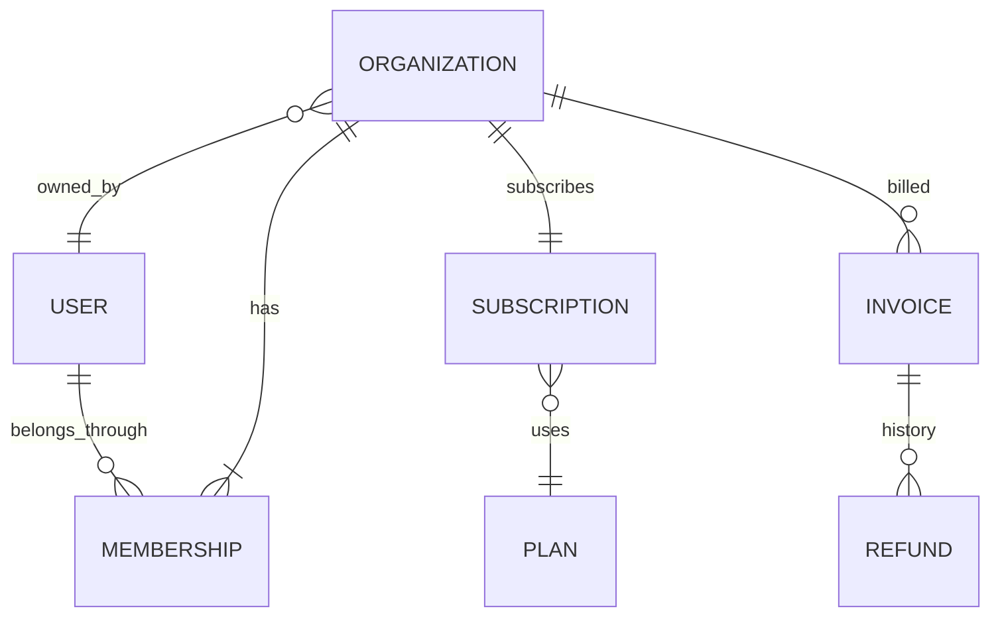

# Usami v0.1

**Usami — A Compositional Business World Benchmark for Interactive AI Agents**

Usami 是可执行的虚构 SaaS 业务世界：组织、成员权限、订阅、席位和账单通过明确 ID 关联，操作能够组合并改变后续操作的可行性。研究者先生成世界，再从实际状态派生结构化请求。评测依据是请求授权、业务规则和实际事件，而不是预先写死的唯一最终答案。

v0.1 只实现业务环境和评测基础设施。没有 LLM、Customer/Service Agent、LLM Judge、进化、攻击搜索、强化学习、支付接口、数据库或 Web 服务。所有数据和操作都在内存沙盒中；业务政策是 Usami 的公开虚构规则。

## 从零运行

需要 Python 3.9+。运行依赖仅 Pydantic 2；开发测试使用 pytest。

```bash
git clone https://github.com/hjy8848/Usami.git
cd Usami
python3 -m venv .venv
source .venv/bin/activate
python -m pip install -e '.[dev]' -c constraints-tested.txt
pytest -q

# 1. 生成并查看关系、订阅与账单
python -m usami generate --seed 42 --count 10 --out outputs/worlds
python -m usami inspect outputs/worlds/world_0001.json

# 2. 从该世界派生结构化场景；场景标签由 ReferenceRules 计算
python -m usami scenarios --world outputs/worlds/world_0001.json --out outputs/scenarios

# 3. 实际执行并保存包含独立 Oracle 结果的完整轨迹
python -m usami simulate --world examples/world.json --scenario examples/scenario.json --out outputs/trace.json

# 4. 独立重新审查，再执行确定性重放
python -m usami evaluate outputs/trace.json --out outputs/report.json
python -m usami replay outputs/trace.json --out outputs/final-state.json

# 5. 运行带 clone/reset、另一操作序列和固定评测的 Python 示例
python examples/demo.py

# 6. 检查 300 个生成世界、三个 split 的 72 个场景及重放
python -m usami validate
python -m usami run-manifest configs/validation-manifest.json --out outputs/validation
```

安装后也可以使用 `usami` 命令。`outputs/` 是可重新生成的运行产物；`examples/` 的世界和场景是公开演示，`configs/validation-manifest.json` 是公开冻结的 Validation，均不声称是盲测 Test。

## 世界状态与生成器

`WorldState` 包含 `users`、`organizations`、`memberships`、`subscriptions`、`invoices` 五个按 ID 索引的集合，以及 seed、生成器版本、配置摘要、完整规则配置和冻结 UTC 时钟。



组织通过 `owner_id` 关联 User，通过 `subscription_id` 关联唯一订阅。Membership 连接用户与组织；同一人能在不同组织担任不同角色。Invoice 关联组织，保存整数分金额、原支付信息和完整 Refund 历史。套餐是独立配置。完整实体对象仅供可信研究 harness 查看；被测执行端应通过有权限检查的查询获得信息。

`WorldGenerator(seed, GeneratorConfig).generate()` 使用受约束采样：先建用户和组织，按套餐容量采样成员，固定唯一 active owner，再依据 active 成员数选择席位。周期和状态相互约束；账单分别从近期支付、超期支付、未支付、历史已退款四类一致历史中采样。退款历史也满足当时的时限，而不要求已退款账单在当前时刻仍可退款。末尾独立检查所有不变量。

每个组织至少有 owner，默认每个组织四张账单；组织和用户数量可配置。不同 seed 改变角色关系、套餐、容量、状态、续费和账单历史。采样使用版本化 SHA-256 counter PRNG，不依赖 Python 标准随机采样实现、系统时间或进程哈希。相同 seed、配置和版本产生相同世界；套餐字典的序列化顺序不影响生成。配置示例见 `configs/standard.json`。

## 公开业务规则

| 项目 | v0.1 规则 |
| --- | --- |
| Owner | 所有操作；只有 owner 可以修改角色；不能转移、降级 owner 或创建第二个 owner |
| Billing Admin | 管理套餐、席位、续费和账单；不能修改角色 |
| Member | 查询所属组织、订阅及成员列表；无账单查询或写权限 |
| 组织边界 | 必须有目标组织 active membership，且资源确实属于目标组织 |
| 套餐 | Starter ≤5、Team ≤20、Business ≤100；名称和上限在 `RulesConfig` 中固定 |
| 席位 | ≥1 且 ≥active 成员数；不得超过当前或目标套餐上限 |
| 订阅 | 套餐、席位及续费操作要求 active；取消续费只把 `auto_renew` 设为 false，保留当前周期与 active 状态 |
| 退款 | 已支付、未退款、距付款 ≤14×24 小时；包含精确的第 14 天边界；必须一次全额退回原渠道 |
| 金额 | 整数分；不计算按比例收费、税、货币兑换或部分退款 |
| 过期 | `clock >= period_end` 时 expired；expired 订阅必须关闭续费 |

`refund_window_days` 和套餐配置可调整，但同一次评测的规则及其 hash 固定。未知规则语义版本不自动套用当前规则。

| 操作 | 参数 / 资源 | 状态转换 |
| --- | --- | --- |
| `change_plan` | `plan_id` / Subscription | 变更套餐，席位和周期不变 |
| `change_seats` | `seats` / Subscription | 更新分配席位 |
| `cancel_renewal` | 无 / Subscription | 关闭下一周期续费 |
| `refund_invoice` | `amount_cents`, `payment_method` / Invoice | paid → refunded，并追加完整 Refund |
| `change_member_role` | `role` / Membership | owner 修改非 owner 的 active 成员角色 |
| `get_organization` | 无 / Organization | 返回组织信息 |
| `get_subscription` | 无 / Subscription | 返回当前订阅 |
| `get_invoice` | 无 / Invoice | 返回账单；需要 billing 权限 |
| `list_members` | 无 / Organization | 返回组织成员关系 |

技术参数使用严格 schema。业务拒绝返回稳定错误码，例如 `PERMISSION_DENIED`、`CROSS_ORG_ACCESS`、`CROSS_ORG_RESOURCE`、`SEAT_LIMIT_EXCEEDED`、`SEATS_BELOW_MEMBERS`、`OWNER_IMMUTABLE`、`REFUND_WINDOW_EXPIRED`、`DUPLICATE_REFUND`、`REFUND_AMOUNT_MISMATCH`、`REFUND_METHOD_MISMATCH`。找不到主体、组织或资源也有独立错误码。严格执行的失败不改变状态；取消续费和设置相同值允许幂等成功，但授权记录只允许执行一次。

## Reference Rules、Sandbox 与 Oracle

三者有明确边界：

1. **ReferenceRules** 是纯业务规范：输入前状态、真实用户 ID 和操作，产生 allowed/error 及完整预期状态、查询结果。它不导入执行器，也不依赖事件中保存的评分。
2. **WorldEngine / reference** 为正常演示和场景校验提供严格执行。它检查可信 RequestContext，再使用 ReferenceRules 的转换结果。
3. **WorldEngine / sandbox** 独立实施技术上可执行的修改，只检查 schema 和实体存在性。它不咨询业务权限、退款或席位规则，所以能够保存实际的违规后状态。`refuse` 模式记录拒绝且不改变状态。
4. **Dynamic Oracle** 独立重新计算 ReferenceRules，审查真实事件、前后快照、请求授权和查询返回值。实际执行端无法通过提供一个 `success` 或保存的 Oracle 分数决定自己的分数。

显式 sandbox 是可观察错误执行的研究机制；没有隐藏漏洞，也不是现实账户安全边界。`tests/test_oracle.py` 中的故意错误记录只验证评分器，不能作为 AI 漏洞发现结果。正常命令默认 `reference`。研究者可对已有结构化场景运行 `--mode sandbox` 或 `--mode refuse`，检查 Oracle 如何审查违规执行及错误拒绝。

### RequestContext 的权威来源

RequestContext 由可信调用方在操作前创建，包括请求人、组织、资源、query/operation 类型、具体操作参数和明确授权列表。授权是对实际 actor、资源、操作和全部参数的精确匹配；执行身份表示请求用户的真实业务主体，而不是另一个拥有更高权限的服务账户。未来 Service 应代表该主体调用工具。

Oracle 不从最终状态反推授权。不允许事后授权或重复使用同一授权来解释先前操作。离线自有轨迹默认把 harness 记录的 RequestContext 当作可信测试输入；面对可修改轨迹的执行端，应从外部受信 Manifest/harness 传入 `trusted_requests`。CLI 支持：

```bash
python -m usami evaluate outputs/validation/SCENARIO_ID.trace.json \
  --manifest configs/validation-manifest.json --scenario-id SCENARIO_ID
```

这里 `SCENARIO_ID` 替换为 Manifest 中真实的 scenario ID。校验 hash 能发现意外损坏，但不是授权认证签名：控制整个文件的人可以重新计算 hash。最终授权和 Manifest 必须由研究 harness 或第三方保管；执行端自行创建的上下文没有权威性。

### 评分依据与证据

每个 RequestEvaluation 输出 `world_id`、`request_id`、`valid_request`、`operation_correct`、`violations` 和 `evidence_event_ids`。有效性以请求事件时的实际状态、权限及授权计算；执行正确性根据操作发生时的状态审查。合法且仍可完成的请求被拒绝得到 `FALSE_REJECTION`；非法请求被正确拒绝得到正确评分。缺失响应会得到 `INCOMPLETE_REQUEST`。

检查同时覆盖：权限及组织边界、授权精确范围、套餐与席位、owner 一致性、退款金额/渠道/时间/重复、订阅状态、合法状态但错误目标结果、拒绝后发生修改或数据披露、查询结果、额外无关修改、政策/时钟修改、预算和状态连续性。

每项违规关联事件 ID 和状态 hash；状态不变量还提供实体路径。全局初始/最终快照问题关联具体状态证据。未知政策、缺失授权来源或缺失前后证据用 JSON `null` 表示未知布尔结论，report `status` 为 `unknown`；已有明确违规时仍返回 `fail`。未知结果不计为正确。报告分别列出合法请求完成数、非法请求正确拒绝数和 unknown，避免“全部拒绝”获得虚假高分。场景的预期标签只用于冻结与校验，Oracle 的评分重新读取实际请求和事件。

## 组合场景、数据划分和公平评测

`generate_scenarios(world)` 从世界现有实体派生查询、合法请求、约束失败、权限边界、未授权、多步退款、套餐降级依赖和“提升角色 → 取消续费 → 退款”等多实体场景。每一步都由 ReferenceRules 在前一步的新状态上计算标签和预期 hash。例如升级到较大套餐后增加席位，立即降级被拒；减少席位后，相同降级操作成功。

Scenario 保存世界 hash、规则 hash、预算、步骤和生成语义版本。执行前重新确认每一步的标签与 hash，不允许随机编造合法性。一个 Scenario 内连续演化状态；不同 Scenario 从相同世界初始快照独立开始。

| Split | 用途与冻结方式 |
| --- | --- |
| Train | `sample_train()` 可按公开生成规则不断采样；也能保存有限 Manifest |
| Validation | 公开冻结配置、seed 清单、Scenario、规则摘要、预算和 Manifest hash，供开发比较 |
| Test | 方法冻结后由独立第三方私有生成、保管和加载；公共演示只能标记 `demo`，不能声称盲测 |

基础 seed 命名空间默认 Train 从 0、Validation 从 1,000,000、Test 从 2,000,000 开始；独立实例按完整 world hash 和剔除 provenance 的业务 fingerprint 双重去重。

组合外推配置的 held-out 条件：同一人在 A 是 active billing_admin、B 是 active member，A 订阅 active 且有可退 paid invoice，B 订阅 expired 且有超期 paid invoice。`train_single` 允许各种角色、账单资格以及 active/expired 规则分别出现，但每个世界的订阅状态同类，因此排除该联合条件；`test_composed` 强制在前两个组织构建该条件。该约束可机器检查，且 Train/Test 使用相同 ID 集合，差异来自业务关系与状态。

这是 v0.1 的基础组合外推机制，不是全面的分布泛化证明。standard Validation 并不保证排除 held-out 组合，所以不能把用它反复调优的结果声称为严格未见组合盲测。需要严格开发隔离时，可用 `configs/train-single.json` 创建 Validation，并由第三方用 `configs/test-composed.json` 私有生成 Test。

```bash
python -m usami manifest --split validation --seed 1000000 --count 2 \
  --out outputs/validation-manifest.json
python -m usami manifest --split validation --config configs/train-single.json \
  --out outputs/compositional-validation.json
# 私有目录默认被 Git 忽略；不要把最终测试实例提交到公共仓库
python -m usami manifest --split test --seed 782901 --count 5 \
  --out private/final-test.json
python -m usami validate --manifest outputs/compositional-validation.json --manifest private/final-test.json
python -m usami run-manifest private/final-test.json --out private/results
```

`load_manifest(path)` 加载第三方文件并重建、验证每个世界和场景。Manifest 固定生成器/场景版本、配置、规则摘要、世界初始状态和每场景操作预算。`assert_fair_comparison(a, b)` 要求双方使用完全相同的 Manifest；每个请求、拒绝和查询都占一次工具操作预算。生成器不会根据某个方法的表现修改分布。公开仓库没有真正保密的最终测试 seeds，代码也不会把可见 Manifest 称为私有安全存储。

## Event Log 与复现

Trace 保存初始完整世界及 hash、规则 hash、预算、generation/request/operation/oracle/final 事件和最终完整世界及 hash。每个 operation 包含执行主体、操作及参数、模式、结果和完整 before/after 状态。事件使用连续 ID 和 SHA-256 hash chain；独立审查忽略日志中旧的 Oracle 判断并重新计算。

`replay_trace()` 先校验链，再从初始快照依次执行请求与操作，逐项比较完整事件（包括 Oracle 结果）和最终 hash。重放不直接复制记录中的最终快照。所有时间来自世界冻结时钟；历史账单也只相对该时钟生成。

`engine.state` 返回深拷贝，输入世界和请求也被复制。`clone_world()` 对 WorldState/WorldEngine 深拷贝；`reset_world(engine)` 恢复最初状态并开始新事件日志。`export_snapshot()` / `import_snapshot()` 支持合法世界的 JSON 往返；违规沙盒状态及其证据通过 Trace 保存和加载，不能当作合法初始世界启动严格引擎。最终化后的引擎需要 reset 才能继续；未最终化的增量 Trace 也可独立评估。

当前使用完整快照来提高审计清晰度，空间开销随实体数×操作数增长。这里的确定性指结构化业务环境和操作重放，不保证未来模型产生相同对话。

## Python API

```python
from usami import (
    WorldEngine, Operation, generate_world, generate_scenarios,
    make_request, execute_operation, evaluate_trace, clone_world,
    reset_world, replay_trace,
)

world = generate_world(seed=42)
org = world.organizations["org_000"]
op = Operation(name="get_subscription", org_id=org.id,
               resource_id=org.subscription_id, params={})
engine = WorldEngine(world, operation_budget=20)
request = make_request("request_001", org.owner_id, op)
engine.register_request(request)  # 可信测试输入，先于执行记录
event = execute_operation(engine, org.owner_id, op, request.request_id)
trace = engine.finish()
report = evaluate_trace(trace, trusted_requests={request.request_id: request})
assert report.status == "pass"
assert replay_trace(trace).state == engine.state
independent_copy = clone_world(engine)
assert reset_world(engine) == world
scenarios = generate_scenarios(world)
```

`WorldEngine` 是有状态会话；`WorldState` 是可序列化快照。正式评测应使用 `simulate_scenario()` 或独立 harness，保证场景边界与预算固定。

## 如何扩展

添加业务操作时：在 `protocol.py` 增加严格参数 schema 和操作名；在 `world/rules.py` 定义纯前置条件、权限、预期转换和新不变量；在 `world/engine.py` 独立实现实际沙盒转换；在 `evaluation/scenario.py` 从已有世界关系派生相关场景。加入合法、非法、状态组合和故意错误记录测试；语义发生变化时更新 rules/generator/scenario 版本，再冻结新的 Manifest。

未来接入 Customer/Service 时，保留 Benchmark 核心：Customer 的真实交互由受信 harness 转成 RequestContext；Service 通过结构化 Operation 调用执行器；轨迹交给独立 Oracle。Service 不能生成权威授权，也不能更改规则、时钟、初始世界或正式预算。v0.1 没有实现对自然语言授权的解释或 Agent 框架。

## 目录与当前限制

```text
usami/world/       数据模型、ReferenceRules、受约束生成器、执行器
usami/evaluation/  Dynamic Oracle、派生 Scenario、split 与 Manifest
usami/protocol.py  请求、精确授权、操作参数和执行结果
usami/events.py    事件链、完整 Trace、完整性校验
usami/randomness.py  版本化确定性采样
usami/__main__.py  CLI
configs/          公开配置和冻结 Validation Manifest
examples/         世界、组合场景和完整 Python 示例
tests/            生成一致性、业务转换、Oracle 故障样例、复现、划分和 CLI
```

只有一个 SaaS 领域、固定模拟时钟、五个写操作、四个查询；没有邀请/删除成员、owner 转让、周期自动推进、按比例收费、部分退款、真实支付、自然语言或任何 Agent。一般不处理某个未知/已非法 pre-state 的后续业务语义，此时 Oracle 返回 unknown，同时保留已确定的不变量违规。哈希提供完整性，不提供敌手环境的签名认证；最终私有 Test 的保密性由独立托管方负责。

真实验收命令、结果和公开 Manifest hash 见 [VERIFICATION.md](VERIFICATION.md)。
