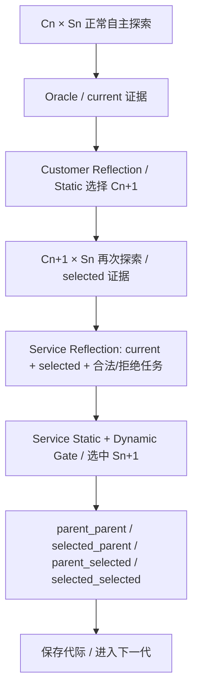
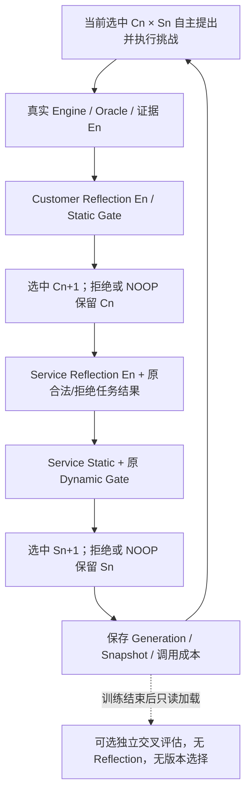

# Recursive Training v3：单条训练链，独立交叉评估

RunConfig schema_version=3，training_protocol=recursive-training-v1；Customer 仍为 customer-static-only-v1。没有新增 Agent、修改 Reflection/Skill Schema 或业务规则。本次仅工程实现与离线测试，没有新在线训练或正式 Held-out。

## RunConfig v4：增加 Service 逐任务回归协议（2026-10-19）

训练顺序仍是 v3 的单链递归流程；新 CLI 训练注册使用 schema_version=4，并冻结 `GatePolicy.service_task_regression_protocol=paired-task-v1`。Service 候选除保留已知错误、业务违规、授权异常、合法任务和正确拒绝等原检查外，还要逐个对照相同的开发任务：如果父版在某个 `legal_completion` 或 `correct_refusal` case 成功，候选在该 case 失败，就拒绝候选。总成功数相互抵消不能再掩盖这类退化。

历史 RunConfig v1–v3 默认并继续使用 `aggregate-v1`，其配置序列化、哈希、Gate 语义和实验结果不被改写。RunConfig v4 只版本化 Gate 判定方式；不修改业务规则、Oracle、Reflection 或任务顺序，也不构成 Skill 已改善的实验结论。

## 修改前的真实顺序（历史 v2）



更新后再次探索是同一环境/预算的额外交互，提供 selected 证据，但没有独立的不可替代机制；current 已包含完整可验证交互。末尾四组 cross 发生在 Reflection 之后，主要用于比较，不被该代学习消费。不是 Service Gate 的 baseline/candidate 验收。

## 修改后的顺序（默认 v3）



每个 exploration_case 在本代只执行一次正常自主交互。第一代使用已配置种子/初态；后续无需人工出新题，由实际选中的 Customer 在允许观察和原预算内决定自然语言挑战。各 Episode 按冻结环境恢复初态，技能跨代继承；本任务不改变世界分布或将业务状态跨代持久化。

Customer 与 Service 反思共享同一组完整 En（包括真实失败与正常执行）。Customer 更新后不再额外出一道比较题；它在下一代正常交互中发挥作用。Service 的输入保留原 preflight 合法任务和正确拒绝任务，并非仅接收固定任务。

Service EvolutionRecord 的 parent_customer_hash 仍指当前实际选中的 Customer；其 Reflection 证据明确记录此前 Cn × Sn 的来源。Service 候选 Gate 仍使用当前选中的 Customer 做 baseline/candidate 开发验收，保留正常业务、拒绝、已知错误回归、违规及授权检查。此类 Gate 内部 Episode 按原逻辑记录，不能与已移除的四组研究比较混淆。

若预算或协议错误使 Reflection 未实际执行，保留原错误、证据、成本及已选中状态，不宣称模型完成了学习。现有显式 Customer 输出错误隔离策略仍可使用，不放松 Replay 或未知结果保护。

## 每代版本和证据

- RunConfig v3 的生成记录为 GenerationRecord v2；current_evidence 即双方共享的 En，selected_customer_evidence/crossings 必须为空。
- Customer/Service EvolutionRecord 保留父版本、候选、实际选中 Snapshot、完整 Reflection/Gate/消费成本。NOOP 明确记录继续使用旧版。
- 原 Archive/native wire journal 保留请求、回复、工具调用、Oracle 与 provider usage，RunStore 继续严格预算预留、缓存、精确 Replay 与检查点恢复。
- 下一代读取上一代实际选中的版本。没有 Customer Performance Gate，没有跨代错误队列。

正常训练 En 全部进入双方 Reflection 的输入；A 组按定义固定 Customer，不调用 Customer Reflector，但同样给 Service En。合法/拒绝 preflight 由 Service 使用。候选 Gate 结果是验收证据，训练后评估结果是研究证据，两者不承诺回流到已经完成的 Reflection；不属于遗漏了正常训练挑战。

## 独立交叉评估

复用原 UsamiAdapter/Agent/Engine/Oracle/Replay，以 `vast_coevo.evaluation.cross.evaluate_cross` 和 `usami-coevo evaluate-cross` 提供独立入口。该函数不接收可写 LibraryStore、Reflector 或 Evolver；只接收复制并校验的已有 Snapshot。

先查看任意代际 hash：

```bash
python -m integrations.usami --root artifacts/train history --id run-B
```

代际记录给出 parent/selected Customer 和 Service hash；将任意组合传给评估，不需要新反思。例如（替换大写占位符）：

```bash
python -m integrations.usami --root artifacts/train --plan independent-evaluation-plan.json \
  evaluate-cross --id post-training --training-run run-B \
  --pair C0S0:C0_HASH:S0_HASH --pair C3S0:C3_HASH:S0_HASH \
  --pair C0S3:C0_HASH:S3_HASH --pair C3S3:C3_HASH:S3_HASH \
  --profile unseen-world --purpose development-diagnostic --output artifacts/post-training
```

plan 固定与训练相同的基础模型，包含一个独立的新 profile；初始库文件字段仅为兼容现有 plan，在此入口不加载/发布它们。CLI 要求源训练完整完成，排除其探索、开发 Gate 和合法/拒绝任务的初态 hash，并拒绝把日志写入训练的 runs/libraries/evidence/native。研究者仍需使用现有世界生成器保证业务结构和分布独立，不能用 ID 改名伪造多样性。

`--purpose development-diagnostic` 和 `--purpose frozen-heldout` 严格匹配配置分区、分别封存日志。跨组合评估属于 Customer 自主探索 Track；Service 固定合法/拒绝 Held-out 的主正确率，继续使用 multigen_heldout.py 原有 finish_evaluation/scored/analyze，不以探索违规数替代。

评估保存不可变 Manifest、完整 Snapshot、预算、每次尝试和原始 evidence，并检查真实 Replay；没有发布、选中或回滚权，不触发 Reflection。输出目录已存在时拒绝重跑。失败保留已知成本或未知预留，不自动重试。为保持实现简单，此独立交叉入口顺序运行；原固定任务 Held-out 的并发配置保持不变。

## 预算与公平性

每个探索世界、每代、每臂默认删除 1 次 selected 比较探索及 4 次 cross，共 5 个 Episode 机会。原典型无 Service 候选的每代 8 场（1 current + 1 selected + 2 任务 + 4 cross）变为 3 场（1 current + 2 任务）；Gate 出现候选时仍按原规则增加开发验收，不能按此数字宣称所有运行固定节省 62.5% Token。

A 固定 Customer/B 更新 Customer 使用相同 v3 循环、世界分布、Agent Prompt、模型和每 Episode/global 上限；少用的调用不转成额外挑战、代数或另一组预算。multigen Manifest 明确记录协议和移除机会。真实 Token 与成本必须由新运行测量，本任务没有新在线结果。

历史 v2 的被删步骤调用与 Token 参考，保存于 experiments/vast_coevo/results/recursive-training-v3-implementation-001/HISTORICAL_OVERHEAD.json；这些只是旧轨迹的组成成本，不是新版因果节省估计。Reflection 输入变化和候选接受会改变实际消耗。

## 历史兼容

RunConfig v1–v3、GenerationRecord v1/v2 的已有字段与内容 hash 保持可读；旧数据不新增 training_protocol、不改写结果。Core 保留显式兼容分支用于旧语义；新 CLI 注册使用 v4，并冻结逐任务 Gate 协议。生产 CLI 读取已有 v3 配置时继续使用其 aggregate-v1 语义，不会替换配置或结果。

旧原生精确 Replay 有源码 pins，必须使用各自 source-snapshot；本次 Core 变化不能用当前源码冒充旧版本。Skill/Oracle/世界数据没有迁移。旧 Manifest 和 Held-out 保持原样，禁止用已查看结果重新选择 Skill。
